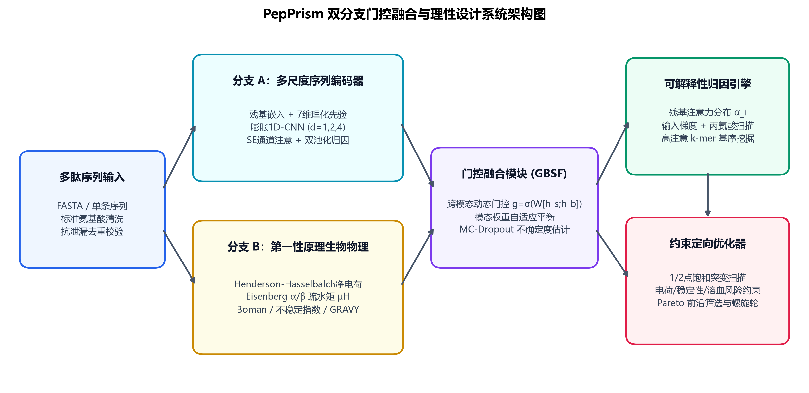
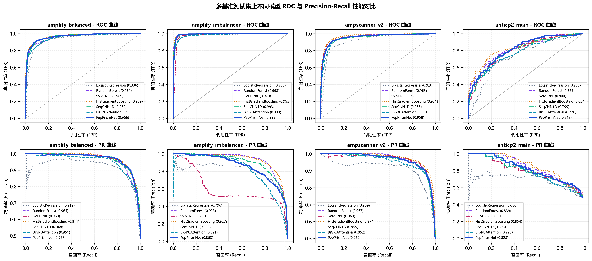
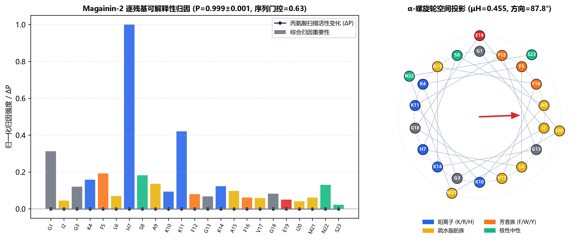
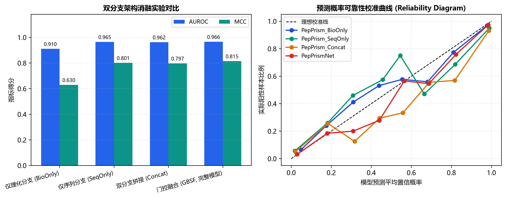
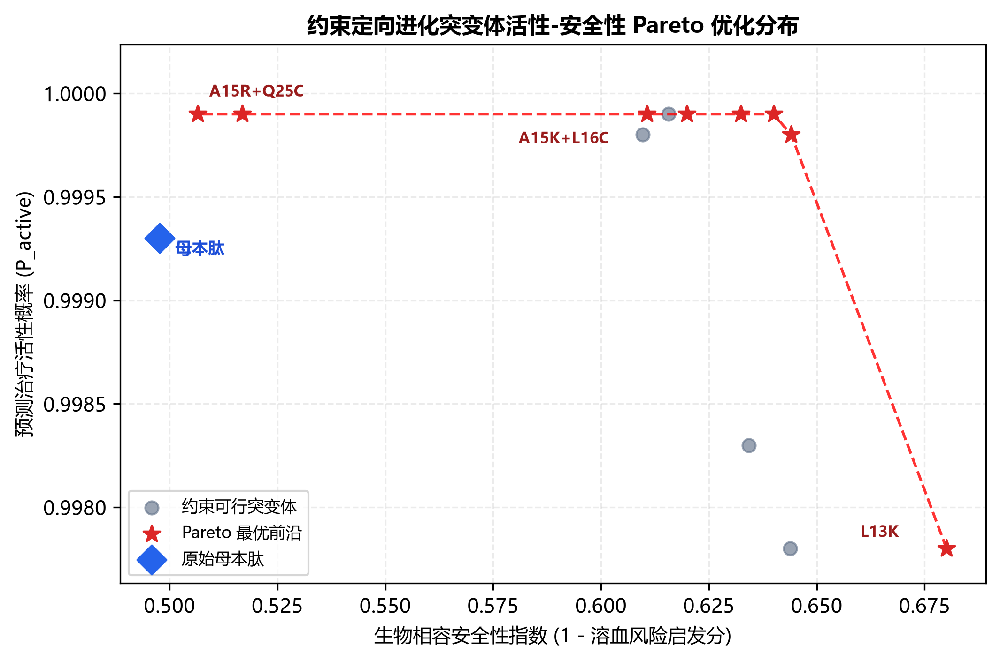
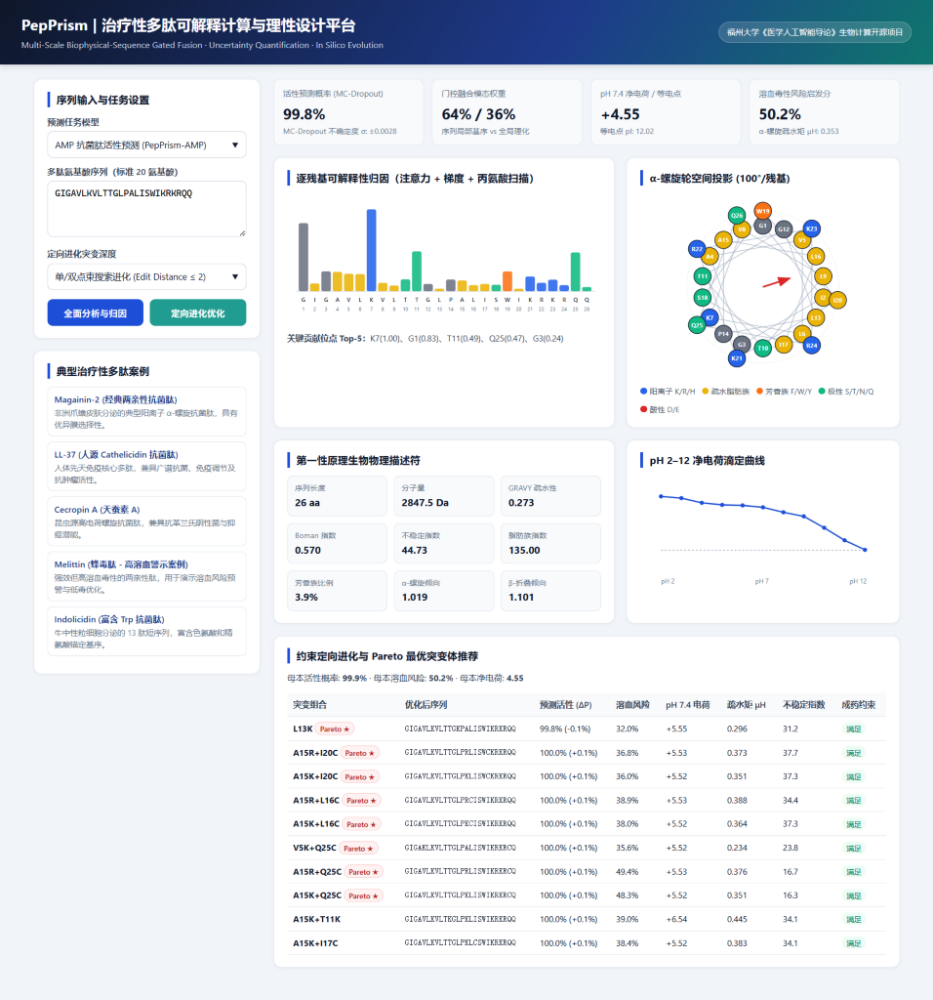

# PepPrism

**An Interpretable Multi-Scale Biophysical-Sequence Fusion Framework for Therapeutic Peptide Discovery and Rational Optimization**

[](LICENSE)
[](pyproject.toml)

[中文文档](README_zh.md)

## Overview

**PepPrism** is an open-source computational biology platform for predicting, explaining, and rationally optimizing therapeutic peptides (Antimicrobial Peptides / AMPs and Anticancer Peptides / ACPs). Rather than treating peptide sequences purely as black-box token streams, PepPrism couples **first-principles biophysical theory** with **multi-scale deep sequence representations** via **Gated Biophysical-Sequence Fusion (GBSF)**.



### Key Innovations & Capabilities

1. **Dual-Branch Gated Biophysical-Sequence Fusion (`PepPrismNet`)**
   - **Sequence Branch**: Combines residue embeddings with 7 standardized per-residue physicochemical channels and sinusoidal positional encoding, processed by stacked **Multi-Scale Dilated 1D Convolutions** (`d = 1, 2, 4`), **Squeeze-and-Excitation (SE) channel attention**, and dual pooling (masked additive residue attention + global max pooling).
   - **Biophysical Branch**: Computes 17 first-principles descriptors including Bjellqvist pH-dependent net charge & isoelectric point (`pI`), Eisenberg $\alpha$-helical ($\delta = 100^\circ$) and $\beta$-sheet ($\delta = 180^\circ$) hydrophobic moments ($\mu_H$), Kyte-Doolittle GRAVY, Boman index, Guruprasad instability index, and Ikai aliphatic index (verified against `Bio.SeqUtils.ProtParam` to $\le 10^{-2}$).
   - **Gated Fusion + Epistemic Uncertainty**: Dynamically weighs local motif features against global biophysical balance per peptide ($g = \sigma(W_g [h_{\text{seq}}; h_{\text{bio}}] + b_g)$) and estimates predictive uncertainty via **MC-Dropout** ($T = 20$).
2. **Leak-Free Benchmarking & Negative-Sampling Bias Audit**
   - Implements an exact **5-mer Prefix Filtering** deduplication index (`Jaccard >= 0.85`) across train/test splits and Kolmogorov-Smirnov (KS) sequence-length bias auditing across 5 public datasets (`AMPlify Balanced`, `AMPlify Imbalanced`, `AMPScanner v2`, `AntiCP 2.0 Main`, `AntiCP 2.0 Alternate`).
3. **Multi-Perspective Explainability Engine**
   - Combines per-residue additive attention, embedding $\times$ gradient saliency, and *in silico* alanine-scanning sensitivity ($\Delta P$) alongside 2D $\alpha$-helical wheel projections and high-attention $k$-mer motif mining.
4. **Constrained *In Silico* Directed Evolution (`optimize`)**
   - Performs 1-point saturation mutagenesis and 2-point beam-search optimization subject to pH 7.4 net charge bounds and Guruprasad stability (`< 40`), identifying **Pareto-optimal** variants trading off potency against a physicochemical hemolysis-risk heuristic.
5. **CLI & Zero-CDN Interactive FastAPI Workbench**
   - Includes a `pepprism` CLI (`predict`, `analyze`, `optimize`, `serve`) and a self-contained web dashboard with live SVG helical wheels, residue attribution bars, pH titration curves, and mutant design tables.

---

## Reproducible Benchmark Results

All benchmarks below were evaluated strictly under the 5-mer prefix-filtered anti-leakage protocol (`seed=42`).

### Main Benchmark Summary (PepPrismNet vs. Baselines)

| Dataset | Task | PepPrismNet AUROC | PepPrismNet AUPRC | PepPrismNet MCC | PepPrismNet ECE | Strongest Baseline AUROC |
| :--- | :---: | :---: | :---: | :---: | :---: | :---: |
| **AMPlify Balanced** | AMP | 0.9664 | 0.9670 | **0.8225** | **0.0245** | 0.9688 (SVM_RBF) |
| **AMPlify Imbalanced (1:30)** | AMP | 0.9926 | 0.8633 | 0.6974 | 0.0258 | 0.9949 (HistGB) |
| **AMPScanner v2** | AMP | 0.9579 | 0.9622 | 0.7886 | **0.0176** | 0.9714 (HistGB) |
| **AntiCP 2.0 Main** | ACP | 0.8171 | 0.8237 | 0.4635 | 0.0561 | 0.8337 (HistGB) / 0.7986 (SeqCNN1D) |
| **AntiCP 2.0 Alternate** | ACP | **0.9722** | **0.9765** | 0.8174 | 0.0397 | 0.9702 (HistGB) |

### Ablation Study (Gated Fusion vs. Single-Branch & Static Concatenation)

| Dataset | Variant | Accuracy | MCC | AUROC | AUPRC | ECE |
| :--- | :--- | :---: | :---: | :---: | :---: | :---: |
| AMPlify Balanced | `BioOnly` (17-d Biophysics MLP) | 0.8129 | 0.6296 | 0.9103 | 0.9137 | 0.0397 |
| AMPlify Balanced | `SeqOnly` (MS-SE-Conv + DualPool) | 0.9004 | 0.8012 | 0.9649 | 0.9640 | 0.0560 |
| AMPlify Balanced | `Concat` (Static Concatenation) | 0.8979 | 0.7971 | 0.9624 | 0.9621 | 0.0612 |
| AMPlify Balanced | **`PepPrismNet` (GBSF + MC-Dropout)** | **0.9074** | **0.8147** | **0.9663** | **0.9669** | **0.0218** |
| AntiCP 2.0 Main | `BioOnly` | 0.6480 | 0.2950 | 0.7240 | 0.7442 | 0.0552 |
| AntiCP 2.0 Main | `SeqOnly` | 0.6978 | 0.4027 | 0.7930 | 0.8065 | 0.1325 |
| AntiCP 2.0 Main | `Concat` | 0.7134 | 0.4262 | 0.7880 | 0.8033 | 0.1147 |
| AntiCP 2.0 Main | **`PepPrismNet` (GBSF + MC-Dropout)** | **0.7259** | **0.4510** | **0.8170** | **0.8237** | **0.0647** |

---

## Installation

```bash
git clone https://github.com/linlinjj/PepPrism.git
cd PepPrism

python -m venv .venv
# Linux/macOS: source .venv/bin/activate
# Windows: .venv\Scripts\activate

pip install torch --index-url https://download.pytorch.org/whl/cpu
pip install -e ".[dev]"
```

## Quick Start

### 1. Interactive Web Workbench

```bash
pepprism serve --host 127.0.0.1 --port 8000
```
Open `http://127.0.0.1:8000` in your browser to analyze peptides (e.g., `Magainin-2`, `LL-37`, `Melittin`), inspect $\alpha$-helical wheel projections and residue attributions, and design Pareto-optimal mutants.

### 2. Command-Line Interface (CLI)

```bash
# Batch FASTA prediction with MC-Dropout uncertainty
pepprism predict --fasta examples/sample_peptides.fasta --task amp --mc-samples 20

# Full biophysical profile + helical wheel + residue attribution report
pepprism analyze --sequence GIGKFLHSAKKFGKAFVGEIMNS --task amp

# Constrained in silico directed optimization (e.g., reducing Melittin hemolysis risk)
pepprism optimize --sequence GIGAVLKVLTTGLPALISWIKRKRQQ --task amp --max-mutations 2 --top-k 10
```

### 3. Reproduce Full Benchmarks & Tests

```bash
# Run all 17 unit & API integration tests
pytest tests/ -v

# Re-run full 5-dataset benchmarks, 5-fold CV, ablations, and figures
python experiments/run_benchmarks.py --seed 42 --epochs 24
```

## Visualizations

| ROC & Precision-Recall Benchmarks | Magainin-2 Residue Attribution & Helical Wheel |
| :---: | :---: |
|  |  |

| Ablation & Reliability Calibration | Melittin Constrained Pareto Optimization |
| :---: | :---: |
|  |  |

### Interactive FastAPI Web Workbench



## Repository Structure

```text
PepPrism/
├── pepprism/
│   ├── biophysics/      # Bjellqvist pH charge, Eisenberg μH, Boman, PseAAC, helical wheel
│   ├── data/            # Public benchmark downloader, 5-mer prefix anti-leakage deduplication
│   ├── models/          # Classical ML baselines, SeqCNN1D, BiGRUAttention, PepPrismNet (GBSF)
│   ├── explain/         # Attention + gradient + alanine-scan attribution, k-mer motif mining
│   ├── design/          # Constrained directed mutagenesis & Pareto frontier ranking
│   ├── viz/             # 300 DPI publication plotting utilities
│   ├── web/             # FastAPI backend & standalone interactive HTML/SVG dashboard
│   └── cli.py           # Typer CLI entry point
├── checkpoints/         # Pre-trained pepprism_amp.pt and pepprism_acp.pt weights
├── experiments/         # Reproducible benchmark pipeline and JSON outputs
├── examples/            # Sample FASTA peptides
└── tests/               # Pytest unit & integration suite
```

## License

Released under the [MIT License](LICENSE). Developed by Junjie Lin (College of Computer and Data Science, Fuzhou University).
