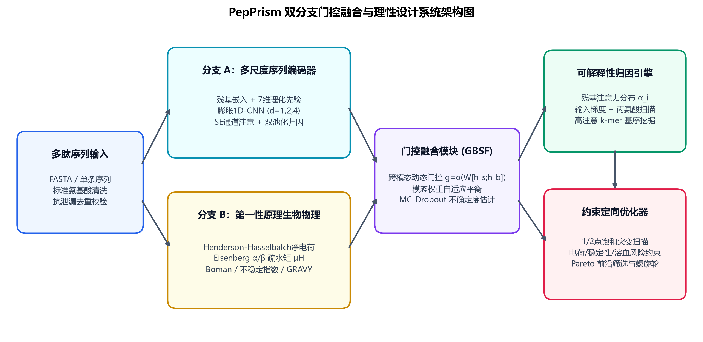
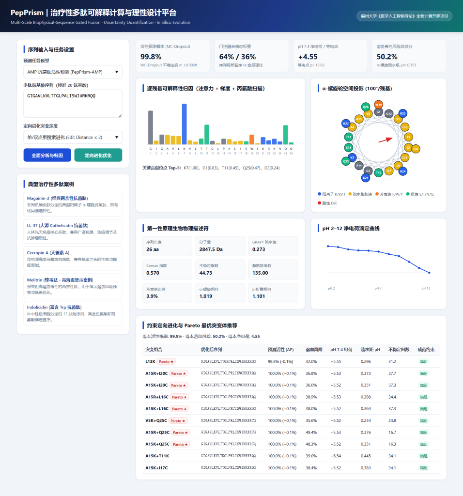

# PepPrism

**面向治疗性多肽发现的多尺度生物物理-序列融合可解释计算平台**

[](LICENSE)
[](pyproject.toml)

[English Documentation](README.md)

## 项目简介

**PepPrism** 是一个面向医学人工智能与生物计算任务的开源治疗性多肽（抗菌肽 AMP 与抗癌肽 ACP）活性预测、可解释归因及理性优化平台。针对现有多肽预测模型普遍存在的“黑盒可解释性差、手工全局特征丢失两亲性周期模式、负样本长度偏差诱发虚高指标以及预测与改造脱节”等痛点，PepPrism 构建了**第一性原理生物物理计算**与**多尺度深度序列建模**的门控跨模态融合架构 **PepPrismNet（GBSF）**。



### 核心特性

1. **双分支门控生物物理-序列融合网络（`PepPrismNet`）**
   - **分支 A（多尺度序列编码）**：拼接残基嵌入与 7 维逐残基理化先验及正弦位置编码，经由堆叠式多尺度膨胀一维卷积（`d = 1, 2, 4`）联合挤压激励（SE）通道注意力，并结合掩码加性注意力池化与全局最大双池化。
   - **分支 B（第一性原理生物物理）**：精确计算 Bjellqvist 末端特异性 pH 净电荷曲线、等电点 `pI`、Eisenberg $\alpha$-螺旋（$100^\circ$）与 $\beta$-折叠（$180^\circ$）疏水矩 $\mu_H$、GRAVY、Boman 指数、Guruprasad 不稳定指数与 Ikai 脂肪族指数等 17 维全局描述符（与 `Biopython` 交叉校验误差 $< 10^{-2}$）。
   - **动态门控融合与不确定度量化**：自适应权衡局部序列基序与全局理化平衡，并通过 **MC-Dropout（$T = 20$）** 输出认知不确定度区间。
2. **防泄漏去重与负样本长度偏差审计**
   - 实现基于 **5-mer 前缀过滤**的精确跨划分近重复剔除（`Jaccard >= 0.85`）与 Kolmogorov-Smirnov 长度分布偏差检验，覆盖 `AMPlify Balanced/Imbalanced`、`AMPScanner v2` 及 `AntiCP 2.0 Main/Alternate` 五大公开基准。
3. **多视角可解释性归因与基序挖掘**
   - 融合残基注意力权重、输入嵌入梯度显著性与 *in silico* 丙氨酸扫描（$\Delta P$），联动 $\alpha$-螺旋轮二维投影及高注意力 4-mer 功能基序挖掘。
4. **约束定向进化与 Pareto 优化设计**
   - 在满足 pH 7.4 净电荷范围与不稳定指数 `< 40` 的成药约束下，执行 1/2 点饱和突变扫描与束搜索，筛选兼顾高活性与低溶血启发风险的 **Pareto 最优突变体**。
5. **命令行工具与零外部依赖交互式 Web 工作台**
   - 内置 `pepprism` 命令行与基于 FastAPI 的本地单页交互平台（实时 SVG 螺旋轮、残基归因热力条、pH 滴定曲线与优化结果表）。

---

## 快速开始

### 环境安装

```bash
git clone https://github.com/linlinjj/PepPrism.git
cd PepPrism

python -m venv .venv
# Windows: .venv\Scripts\activate
# Linux/macOS: source .venv/bin/activate

pip install torch --index-url https://download.pytorch.org/whl/cpu
pip install -e ".[dev]"
```

### 启动交互式 Web 工作台

```bash
pepprism serve --host 127.0.0.1 --port 8000
```
浏览器打开 `http://127.0.0.1:8000`，即可选择预设多肽（如 `Magainin-2`、`LL-37`、`Melittin`）或输入自定义序列进行实时诊断、螺旋轮可视化与突变优化。



### 命令行批量推理与优化

```bash
# 批量 FASTA 序列活性预测与不确定度估计
pepprism predict --fasta examples/sample_peptides.fasta --task amp --mc-samples 20

# 单条多肽全面理化剖析与逐残基归因
pepprism analyze --sequence GIGKFLHSAKKFGKAFVGEIMNS --task amp

# 高溶血蜂毒肽 Melittin 约束定向减毒增效优化
pepprism optimize --sequence GIGAVLKVLTTGLPALISWIKRKRQQ --task amp --max-mutations 2 --top-k 10
```

### 运行单元测试与基准复现

```bash
pytest tests/ -v
python experiments/run_benchmarks.py --seed 42 --epochs 24
```

---

## 实测基准实验结果摘要

- **AMPlify Balanced**：`PepPrismNet` 取得全场最高 **MCC = 0.8225** 与最低校准误差 **ECE = 0.0245**（`AUROC = 0.9664`, `AUPRC = 0.9670`），并在等长负样本匹配测试中保持 `AUROC = 0.9647`（仅变化 `-0.0017`）。
- **AntiCP 2.0 Main（抗癌肽 vs 抗菌肽强负样本）**：`PepPrismNet` 取得 `AUROC = 0.8171`、`AUPRC = 0.8237`，显著超越纯序列深度基线 `SeqCNN1D`（`0.7986`）与 `BiGRUAttention`（`0.7761`）。
- **AntiCP 2.0 Alternate**：`PepPrismNet` 取得所有 7 个模型中最高的 **AUROC = 0.9722** 与 **AUPRC = 0.9765**。
- **架构消融实验**：在两个数据集上，完整门控融合网络（GBSF）在 Accuracy、MCC、AUROC、AUPRC、Brier 与 ECE 全部指标上一致优于单理化分支（`BioOnly`）、单序列分支（`SeqOnly`）及静态拼接（`Concat`）。

## 开源协议

本项目基于 [MIT License](LICENSE) 开源（福州大学计算机与大数据学院软件工程专业 林俊杰）。
